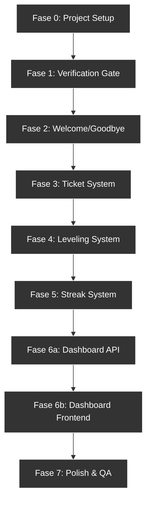

# Implementation Plan — Cozy Bot

> **Konteks**: Dokumen ini adalah rencana implementasi detail untuk Cozy Bot berdasarkan analisis PRD Final. Setiap fase dipecah menjadi task-task granular yang bisa dikerjakan secara independen per sesi.
>
> **Referensi**: [PRD Final](file:///d:/api/cozy-bot/PRD%20Final%20-%20Cozy%20Bot%20Discord.md) | [CONVENTIONS.md](file:///d:/api/cozy-bot/CONVENTIONS.md) | [CHECKPOINT.md](file:///d:/api/cozy-bot/CHECKPOINT.md)

---

## Ringkasan Analisis PRD

### Apa yang Akan Dibangun
Cozy Bot adalah Discord bot **all-in-one** milik komunitas "Cozy For Us" dengan 6 fitur inti + web dashboard + modul minigame:

1. **Member Verification Gate** — Sistem verifikasi berbasis reaction
2. **Welcome & Goodbye** — Pesan sambutan/perpisahan otomatis
3. **Ticket System** — Sistem tiket (Support, Report, Suggestion)
4. **Leveling System** — XP dari voice & text activity
5. **Streak System** — Streak harian antar 2 member
6. **Cozy Dashboard** — Web admin panel dengan Discord OAuth2
7. **Cozy Economy & Minigames System** — Cozy Cash, Bank (*Safe Cash*), Cozy Slots (5 simbol kustom), Cozy Mines (`cmines`), Coinflip, Lottery harian, dan Drop & Pickup

### Prinsip Arsitektur (Finalized)
- **Flat monorepo** — single `package.json`, bot + API dalam 1 process Node.js
- **Shared database** — MySQL dari Pterodactyl panel (mc.anjas.id:3306)
- **Modular per fitur** — Setiap fitur terisolasi di modul sendiri
- **Single-server first** — Didesain untuk 1 guild, arsitektur siap multi-guild nanti
- **1 process architecture** — Bot + Fastify API dalam 1 process (hemat RAM, Pterodactyl constraint: 2GB)
- **Dashboard static build** — Next.js di-build jadi static files, di-serve oleh Fastify
- **Command Style Hybrid** — Pure slash commands untuk sistem utilitas/admin/dashboard, dan **Direct Text Commands** (tanpa `/`) untuk Cozy Minigames & Economy agar cepat dan simpel
- **Visual konsisten** — Black & white theme di semua output embed

### Hosting Constraints (Pterodactyl Panel)
| Resource | Limit |
|---|---|
| RAM | 2 GB |
| Storage | 10 GB SSD |
| Bandwidth | Unmetered |
| Database | MySQL (mc.anjas.id:3306) |
| Process manager | Pterodactyl built-in (bukan PM2) |
| Port | Assigned by panel |

---

## Fase 0: Project Setup & Foundation

> **Estimasi**: 1 hari
> **Prasyarat**: Approval dari YP

### Task 0.1: Initialize Project
```
Langkah:
1. npm init di root folder cozy-bot/
2. Setup TypeScript config:
   - tsconfig.json (base, strict mode)
   - tsconfig.bot.json (extends base, paths alias @/ → src/)
3. Install dependencies (single package.json):
   - Core: typescript, tsx, @types/node
   - Discord: discord.js
   - Database: prisma, @prisma/client
   - API: fastify, @fastify/cors, @fastify/jwt, @fastify/static, @fastify/rate-limit
   - Logging: pino, pino-pretty
   - Utils: dotenv, zod (config validation)
   - Dev: vitest, @types/*
4. Buat .env.example dengan semua variabel:
   - DISCORD_TOKEN, DISCORD_CLIENT_ID, DISCORD_CLIENT_SECRET
   - GUILD_ID, DATABASE_URL, SERVER_PORT, OWNER_ID
   - NODE_ENV, LOG_LEVEL, DASHBOARD_URL, JWT_SECRET
5. Buat .gitignore:
   - node_modules, .env, dist/, dashboard-out/
   - prisma/*.db, *.log
6. Setup path aliases (@/ → src/) via tsconfig paths
```

### Task 0.2: Database Schema (Initial)
```
Langkah:
1. npx prisma init (provider: mysql)
2. Buat schema.prisma dengan tabel awal:
   - users (discord_id PK, username, is_verified, joined_at, updated_at)
   - guild_config (guild_id PK + semua field konfigurasi)
   - audit_log (id PK auto, actor_discord_id, action, detail JSON, source, created_at)
3. Konfigurasi DATABASE_URL dari Pterodactyl panel
4. npx prisma migrate dev --name init
5. Buat src/shared/database.ts (Prisma singleton with connection pooling)
```

### Task 0.3: Bot + API Foundation (1 Process)
```
Langkah:
1. Buat src/index.ts (MAIN ENTRY POINT):
   - Initialize Prisma connection
   - Initialize CozyClient (Discord bot)
   - Initialize Fastify server (API)
   - Fastify serves dashboard static files from dashboard-out/
   - Graceful shutdown handler

2. Buat src/bot/client.ts (CozyClient extends Discord.Client):
   - Intents: Guilds, GuildMembers, GuildMessages, GuildMessageReactions,
              GuildVoiceStates
   - Partials: Message, Reaction, GuildMember, Channel
   - Properties: commands (Collection), config

3. Buat src/bot/handlers/:
   - command-handler.ts: scan & load commands dari commands/
   - event-handler.ts: scan & load events dari events/
   - component-handler.ts: route button/selectmenu/modal interactions

4. Buat src/bot/register-commands.ts:
   - Script terpisah untuk deploy slash commands ke Discord API
   - Dipanggil manual: npx tsx src/bot/register-commands.ts

5. Buat src/shared/ utilities:
   - config.ts: load & validate .env menggunakan Zod
   - constants.ts: COLORS, EMOJI, limits
   - logger.ts: Pino logger instance
   - audit-logger.ts: helper untuk write audit_log
   - types.ts: shared interfaces

6. Buat src/bot/utils/:
   - embed-builder.ts: createCozyEmbed() factory
   - permission-check.ts: isAdmin(), isStaff(), isOwner()
   - pagination.ts: paginated embed builder
   - rate-limiter.ts: in-memory rate limiter

7. Buat src/api/server.ts:
   - Fastify setup with CORS, JWT, rate-limit
   - Static file serving untuk dashboard
   - Health check endpoint: GET /api/v1/health
```

### Task 0.4: Folder Structure
```
Buat seluruh folder structure sesuai CONVENTIONS.md Section 2.
Buat placeholder files untuk setiap folder agar terlihat di git.
Jangan buat file kosong — buat barrel exports (index.ts) yang bermakna.
```

---

## Fase 1: Member Verification Gate

> **Estimasi**: 1-2 minggu
> **Prioritas**: TERTINGGI — ini harus selesai dan stabil sebelum fitur lain

### Task 1.1: Verification Service
```
File: src/bot/modules/verification/verification.service.ts
File: src/bot/modules/verification/verification.types.ts

Logic:
- getConfig(guildId): Promise<VerificationConfig | null>
- saveConfig(guildId, config): Promise<void>
- verifyMember(member, actorId?, source?): Promise<void>
  1. Check apakah sudah verified (idempotent)
  2. Remove @Unverified role
  3. Add @Verified role
  4. Update DB: users.is_verified = true
  5. Log ke audit_log
  6. Return success
- unverifyMember(member, actorId, source): Promise<void> (opsional)
- isVerified(discordId): Promise<boolean>
- getUnverifiedMembers(guildId): Promise<User[]>
- setupVerification(guildId, config): Promise<void>
  1. Validate channel exists
  2. Validate roles exist
  3. Check bot permission hierarchy
  4. Save config to DB
```

### Task 1.2: Events
```
File: src/bot/events/guildMemberAdd.ts
- Assign @Unverified role ke member baru
- Buat/update record di tabel users
- Log action

File: src/bot/events/messageReactionAdd.ts
- Check: reaction di pesan panel verifikasi?
- Check: emoji sesuai config?
- Check: bukan bot?
- Check: user belum verified?
- Panggil verificationService.verifyMember()
- Kirim konfirmasi (DM atau reply sementara auto-delete)

File: src/bot/events/ready.ts (update)
- Fetch & cache pesan panel verifikasi agar reaction lama terdeteksi
```

### Task 1.3: Commands
```
File: src/bot/commands/verify/verify-setup.ts
- Slash command: /verify-setup
- Options: channel, emoji, unverified_role, verified_role
- Permission: Administrator only
- Flow: validate inputs → save config → confirm

File: src/bot/commands/verify/verify-panel.ts
- Slash command: /verify-panel
- Options: (none, atau subcommand send/edit)
- Permission: Administrator only
- Flow: build embed → send ke verify channel → add reaction emoji → save message ID

File: src/bot/commands/verify/verify-config.ts
- Slash command: /verify-config
- Subcommand: view
- Permission: Administrator only
- Flow: fetch config → display as embed

File: src/bot/commands/verify/verify-force.ts
- Slash command: /verify force
- Options: target user
- Permission: Administrator only
- Flow: validate → verifyMember(target, actor, 'manual') → confirm
```

### Task 1.4: Startup Recovery
```
Di event ready.ts:
1. Fetch guild config dari DB
2. Jika verify channel & message ID ada:
   - Fetch message (partial → full)
   - Cache message agar reaction events terdeteksi
3. Check semua reaction yang sudah ada tapi belum diproses (jika bot sempat offline)
4. Log startup status
```

### Task 1.5: Testing & Validation
```
1. Unit test: verification.service.ts (mock Prisma & Discord)
2. Manual test di server Cozy For Us:
   - Join dengan akun test → dapat @Unverified ✅
   - React ✅ → role swap ke @Verified ✅
   - Channel akses terbuka ✅
   - React ulang → no-op (idempotent) ✅
   - Bot restart → reaction lama masih terdeteksi ✅
   - /verify-setup, /verify-panel, /verify-config, /verify force → semua jalan ✅
3. Cek audit_log tercatat setiap aksi
```

### Definition of Done (Fase 1)
- [ ] Member baru otomatis dapat @Unverified
- [ ] Reaction ✅ berhasil swap role, termasuk setelah bot restart
- [ ] Semua admin commands berfungsi
- [ ] Diuji langsung di server Cozy For Us
- [ ] Audit log mencatat setiap verifikasi

---

## Fase 2: Welcome & Goodbye System

> **Estimasi**: 3-5 hari
> **Prasyarat**: Fase 1 selesai & stabil

### Task 2.1: Database Update
```
Update schema.prisma:
- guild_config tambah field:
  - welcome_channel_id
  - welcome_templates (JSON array of template strings)
  - welcome_trigger ('on_verify' | 'on_join')
  - goodbye_channel_id
  - goodbye_templates (JSON array)
  - welcome_image_url (opsional)
  - goodbye_image_url (opsional)
- Migrate database
```

### Task 2.2: Welcome/Goodbye Service
```
File: src/bot/modules/welcome/welcome.service.ts

Logic:
- sendWelcome(member): Promise<void>
  1. Fetch config
  2. Pick random template dari pool
  3. Replace variables: {user}, {server}, {member_count}
  4. Build embed (B&W + image dekoratif)
  5. Send ke welcome channel
- sendGoodbye(member): Promise<void>
  1. Similar flow tapi untuk goodbye
- getConfig(guildId): Promise<WelcomeConfig>
- updateConfig(guildId, config): Promise<void>
- parseTemplate(template, member): string
  - Replace {user} → mention
  - Replace {server} → guild name
  - Replace {member_count} → guild member count
```

### Task 2.3: Events
```
Update guildMemberAdd.ts:
- Jika welcome_trigger === 'on_join': panggil sendWelcome()

Update verification flow:
- Jika welcome_trigger === 'on_verify': setelah verifyMember() sukses, panggil sendWelcome()

Buat guildMemberRemove.ts:
- Panggil sendGoodbye()
```

### Task 2.4: Commands
```
/welcome-setup → set channel, templates, trigger mode
/goodbye-setup → set channel, templates
/welcome-test  → preview welcome embed (pakai data user yang menjalankan command)
```

### Task 2.5: Embed Design
```
Welcome embed:
- Color: 0x0D0D0D
- Title: random dari pool ("Halowww!", "Welcome to the Cozy side!", dll)
- Description: template message
- Thumbnail: user avatar
- Image: GIF/gambar dekoratif (B&W)
- Footer: "Cozy For Us 🤍 • Member ke-{count}"

Goodbye embed:
- Similar structure, tone perpisahan
```

---

## Fase 3: Ticket System

> **Estimasi**: 1 minggu
> **Prasyarat**: Fase 2 selesai

### Task 3.1: Database
```
Tabel tickets sudah ada di schema awal.
Tambah field:
- ticket_number (auto-increment per guild)
- transcript (TEXT, opsional simpan di DB)

Tambah tabel:
- ticket_messages (id, ticket_id, author_id, content, created_at) → untuk transkrip
```

### Task 3.2: Ticket Service
```
File: src/bot/modules/ticket/ticket.service.ts

Logic:
- createTicket(userId, category, guildId): Promise<Ticket>
  1. Check limit (1 aktif per kategori per user)
  2. Generate ticket number
  3. Create private channel/thread
  4. Set permissions (user + staff only)
  5. Send initial embed di channel ticket
  6. Save ke DB
  7. Log ke audit
- closeTicket(ticketId, closedBy): Promise<void>
  1. Generate transcript
  2. Send transkrip ke channel log
  3. DM transkrip ke pembuat ticket
  4. Archive/delete channel
  5. Update DB status → closed
- claimTicket(ticketId, staffId): Promise<void>
- getActiveTickets(guildId, filters?): Promise<Ticket[]>
- generateTranscript(ticketId): Promise<string>
```

### Task 3.3: Components
```
Select Menu:
- Custom ID: "ticket:create"
- Options: Support, Report, Suggestion
- Handler: panggil createTicket()

Button "Close Ticket":
- Custom ID: "ticket:close:{ticketId}"
- Confirmation modal sebelum close

Button "Claim Ticket":
- Custom ID: "ticket:claim:{ticketId}"
- Staff-only (check role)
```

### Task 3.4: Commands
```
/ticket-panel → send dropdown embed ke channel
/ticket-config → atur kategori, staff roles, log channel
```

---

## Fase 4: Leveling System

> **Estimasi**: 1-2 minggu
> **Prasyarat**: Fase 3 selesai

### Task 4.1: Database
```
Tabel leveling sudah ada di schema awal.
Tambah tabel:
- level_rewards (id, guild_id, level, role_id, type: 'voice' | 'text' | 'both')
- level_config (guild_id, voice_xp_rate, text_xp_rate, text_xp_cooldown,
                 levelup_channel_id, enabled_voice, enabled_text)
```

### Task 4.2: Leveling Service
```
File: src/bot/modules/leveling/leveling.service.ts

Logic:
- addVoiceXP(userId, guildId, minutes): Promise<LevelUpResult | null>
- addTextXP(userId, guildId): Promise<LevelUpResult | null>
  1. Check cooldown
  2. Add XP
  3. Calculate level
  4. If level up: return result with old/new level
- calculateLevel(xp): number (formula: level = floor(sqrt(xp / 100)))
- xpForLevel(level): number (reverse formula)
- getLeaderboard(guildId, type, page, perPage): Promise<LeaderboardEntry[]>
- getRank(userId, guildId): Promise<RankData>
- checkAndAssignRewards(userId, guildId, level): Promise<void>
```

### Task 4.3: Voice Tracking
```
File: src/bot/events/voiceStateUpdate.ts

Logic:
- Track join/leave voice channel
- Gunakan in-memory map untuk track waktu mulai
- Setiap interval (1 menit), hitung XP untuk semua user di VC
- Ignore: AFK channel, muted/deafened (opsional configurable)
- Periodic flush ke database (setiap 5 menit untuk mengurangi DB writes)
```

### Task 4.4: Text XP
```
Update messageCreate event:
- Check cooldown (60 detik default)
- Panggil addTextXP()
- Jika level up: kirim notifikasi
```

### Task 4.5: Level-Up Card (Canvas)
```
File: src/bot/canvas/level-card.ts

Design:
- Background: gradient grayscale gelap
- Avatar: circular crop, border putih
- Username: font bold putih
- Level: besar, eye-catching
- Progress bar: grayscale, thin, elegant
- XP text: "1,234 / 5,000 XP"
- Footer: "Cozy For Us"

Output: Buffer (PNG) → AttachmentBuilder
```

### Task 4.6: Commands
```
/rank [user] → tampilkan level card (canvas image)
/leaderboard voice → embed dengan pagination (buttons Prev/Next)
/leaderboard text  → same
/level-config → admin: atur XP rate, rewards, channel
```

---

## Fase 5: Streak System

> **Estimasi**: 1 minggu
> **Prasyarat**: Fase 4 selesai

### Task 5.1: Database
```
Tabel streaks sudah ada di schema awal.
Tambah field:
- started_at (DateTime)
- broken_at (DateTime, nullable)
- request_expires_at (DateTime) → untuk auto-expire

Tambah tabel:
- streak_config (guild_id, reset_hour, request_expire_minutes, notification_channel_id)
```

### Task 5.2: Streak Service
```
File: src/bot/modules/streak/streak.service.ts

Logic:
- requestStreak(fromId, toId, guildId): Promise<StreakRequest>
  1. Check: sudah ada streak aktif antara keduanya?
  2. Check: ada pending request?
  3. Create streak record (status: pending)
  4. Set expires_at (60 menit)
  5. Send embed dengan button Terima/Tolak
- acceptStreak(streakId, userId): Promise<void>
- declineStreak(streakId, userId): Promise<void>
- continueStreak(userId, partnerId, guildId): Promise<ContinueResult>
  1. Check: streak aktif?
  2. Check: sudah continue hari ini?
  3. Send embed dengan reaction 🔥 dari partner
- confirmStreak(streakId, userId): Promise<void>
  1. Partner react 🔥
  2. streak_count++
  3. Update last_confirmed_at
- checkDailyReset(): Promise<void> (cron job)
  1. Find semua streak yang belum confirmed hari ini
  2. Mark as broken / freeze (configurable)
  3. Notify users
- getLeaderboard(guildId, page): Promise<StreakLeaderboardEntry[]>
- getStatus(userId, guildId): Promise<StreakStatus>
```

### Task 5.3: Components & Events
```
Button Terima/Tolak:
- Custom ID: "streak:accept:{streakId}", "streak:decline:{streakId}"

Reaction 🔥:
- Detect pada pesan streak continue
- Validate: reactor adalah partner
- Panggil confirmStreak()

Cron job:
- Setiap 00:00 WIB: checkDailyReset()
- Auto-expire pending requests
```

### Task 5.4: Commands
```
/streak request @user
/streak continue @user
/streak status [@user]
/streaklb → leaderboard + pagination
/streak-config → admin settings
```

---

## Fase 6: Cozy Dashboard

> **Estimasi**: 2-3 minggu
> **Prasyarat**: Fase 1-5 selesai & stabil

### Fase 6a: Backend API + Auth (1 minggu)

#### Task 6a.1: Fastify Server Setup
```
File: src/api/index.ts

Setup:
- Fastify instance
- CORS (allow dashboard URL)
- JWT plugin
- Rate limiting
- Error handler
- Route registration
```

#### Task 6a.2: Discord OAuth2 Auth
```
File: src/api/routes/auth.routes.ts
File: src/api/middleware/auth.middleware.ts

Flow:
1. GET /api/v1/auth/login → redirect ke Discord OAuth2
2. GET /api/v1/auth/callback → exchange code → get token → get user info
3. Check user role di server Cozy For Us via Discord API
4. Generate JWT (payload: discord_id, username, roles, access_level)
5. Set httpOnly cookie
6. Redirect ke dashboard

Middleware:
- requireAuth: validate JWT
- requireRole(level): check access_level >= required
```

#### Task 6a.3: RBAC Middleware
```
File: src/api/middleware/rbac.middleware.ts

Levels:
- OWNER (YP) → full access
- ADMIN → all modules except system settings
- STAFF → limited modules (ticket, verification)

Logic:
- Decode JWT → get roles
- Check roles against Discord server (periodic re-validation)
- Map Discord roles → dashboard access level
```

#### Task 6a.4: API Routes
```
Untuk setiap modul, buat CRUD routes:
- verify.routes.ts   → GET config, PATCH config, POST force-verify, GET unverified-list
- welcome.routes.ts  → GET config, PATCH config
- ticket.routes.ts   → GET list, GET detail, GET transcript
- leveling.routes.ts → GET leaderboard, GET config, PATCH config
- streak.routes.ts   → GET leaderboard, POST reset, GET config, PATCH config
- audit.routes.ts    → GET list (with pagination & filters)

Setiap mutation (POST/PATCH/DELETE) → log ke audit_log
```

### Fase 6b: Frontend Dashboard (2 minggu)

#### Task 6b.1: Next.js Setup
```
- Init Next.js 14 (App Router)
- Tailwind CSS config (black & white theme)
- Layout: dark sidebar + main content
- Auth context (store JWT, handle redirect)
- API client helper (fetch wrapper with auth)
```

#### Task 6b.2: Pages & Components
```
Pages:
- /login          → Discord OAuth2 login button
- /dashboard      → Overview stats
- /verification   → Verification config + unverified list
- /welcome        → Template editor + live preview
- /tickets        → Ticket list with filters
- /tickets/:id    → Ticket detail + transcript
- /leveling       → Leaderboard table + config
- /streaks        → Streak leaderboard + history
- /audit-log      → Audit log with filters
- /settings       → System settings (owner only)

Shared Components:
- Sidebar (responsive, collapsible)
- DataTable (sortable, searchable, paginated)
- StatsCard
- ConfigForm
- Modal (confirm actions)
- Toast (notifications)
```

#### Task 6b.3: Theme & Visual
```
Tailwind config:
- colors: { cozy: { black: '#0D0D0D', white: '#FFFFFF', gray: '#B3B3B3', ... } }
- Dark mode default
- Fonts: Inter atau Outfit dari Google Fonts
- Glassmorphism cards (subtle)
- Smooth transitions
```

---

## Fase 7: Polish & QA

> **Estimasi**: 3-5 hari

### Task 7.1: Visual Audit
```
- Cek semua embed mengikuti tema B&W
- Cek semua canvas cards konsisten
- Cek dashboard responsive di mobile
- Cek favicon & metadata
```

### Task 7.2: QA Checklist
```
Per fitur:
- Happy path ✅
- Edge cases (lihat PRD Section 14) ✅
- Error handling graceful ✅
- Permission checks ✅
- Audit log tercatat ✅
```

### Task 7.3: Production Deploy
```
- Setup PM2 ecosystem config
- Database backup cron
- Environment production config
- SSL & domain setup (dashboard)
- Monitoring & alerting
```

---

## Dependency Graph (Alur Pengerjaan)



---

## Resolved Decisions (dari Open Questions)

> [!NOTE]
> Semua pertanyaan sudah dijawab oleh YP pada 2026-09-08.

| # | Pertanyaan | Keputusan | Alasan |
|---|---|---|---|
| 1 | Database | **MySQL** (dari Pterodactyl panel) | Hosting menyediakan MySQL, Prisma support penuh, sudah di-setup |
| 2 | Role Server | **Owner menyediakan sendiri** | @Unverified & @Verified sudah ada, bot tidak perlu buat |
| 3 | Hosting | **Pterodactyl Panel** (Anjas Tech, Epic plan) | 2GB RAM, 10GB SSD, MySQL, Rp30.000/bulan |
| 4 | Domain | **Belum ada** | Dashboard bisa diakses via IP:port dulu |
| 5 | Discord Bot App | **Belum dibuat** | YP perlu buat di Discord Developer Portal |
| 6 | Monorepo | **Flat monorepo** (single package.json) | Pterodactyl constraint, 1 entry point |
| 7 | TypeScript | **Ya, semua TypeScript** | Type-safe, maintainable |
| 8 | Legacy Support | **Pure slash commands** | Modern, tidak perlu MessageContent intent |

---

## Pre-requisite Sebelum Coding

> [!IMPORTANT]
> YP perlu melakukan langkah ini sebelum AI bisa mulai coding:

1. **Buat Discord Bot Application** di [Discord Developer Portal](https://discord.com/developers/applications):
   - Klik "New Application" → nama: "Cozy Bot"
   - Tab "Bot" → klik "Add Bot"
   - Copy **Token** → simpan aman
   - Copy **Application ID** (= Client ID)
   - Tab "OAuth2" → copy **Client Secret**
   - Enable intents: **Server Members**, **Message Content** (untuk reaction detection)
2. **Invite bot ke server** Cozy For Us:
   - OAuth2 URL Generator → scopes: `bot`, `applications.commands`
   - Permissions: `Administrator` (atau minimal: Manage Roles, Send Messages, Add Reactions, Read Message History, View Channels, Manage Channels)
3. ~~Siapkan PostgreSQL database~~ **Database MySQL sudah di-setup** ✅:
   - Database: `s3332_cozybot_db`
   - Username: `u3332_3maeST5cet`
   - Endpoint: `mc.anjas.id:3306`
   - CONNECTION STRING sudah tersedia dari panel
4. **Catat Role IDs**:
   - ID role `@Unverified`
   - ID role `@Verified`
   - ID role Staff, Admin (jika sudah ada)
5. **Catat Guild ID** server Cozy For Us

---

## Estimated Timeline

| Fase | Fitur | Estimasi | Akumulatif |
|---|---|---|---|
| Fase 0 | Project Setup | 1 hari | 1 hari |
| Fase 1 | Verification Gate | 1-2 minggu | ~2 minggu |
| Fase 2 | Welcome/Goodbye | 3-5 hari | ~3 minggu |
| Fase 3 | Ticket System | 1 minggu | ~4 minggu |
| Fase 4 | Leveling System | 1-2 minggu | ~6 minggu |
| Fase 5 | Streak System | 1 minggu | ~7 minggu |
| Fase 6 | Dashboard | 2-3 minggu | ~10 minggu |
| Fase 7 | Polish & QA | 3-5 hari | **~11 minggu** |

> **Total estimasi: ~2.5-3 bulan** untuk seluruh proyek dari nol hingga production.

---

---

## Fase Ekstra: Cozy Economy & Minigames System (Rework OwO ke Cozy Bot + Cozy Mines)

> **Konteks**: Modul ekonomi dan minigame mandiri yang dirombak total dari sistem OwO Bot menjadi milik Cozy Bot, dilengkapi minigame **Cozy Mines (`cmines`)** yang mengadaptasi Xera Bot (menggantikan Blackjack yang dinonaktifkan untuk fase mendatang), serta sistem **Bank (*Safe Cash*)**, **Daily/Weekly Reward dengan Streak**, dan **Leaderboard Sultan (`ctop`)**.
> 
> **Gaya Perintah**: **Direct Text Commands** tanpa garis miring (`/`) agar interaksi cepat, simpel, dan ramah di chat Discord.

### 1. Ringkasan Fitur & Daftar Perintah
| Perintah | Status | Deskripsi / Catatan |
| :--- | :---: | :--- |
| `ccash` / `cozycash` | **AKTIF (Tahap 1)** | Cek saldo dompet (Cash) & brankas (Bank) format bahasa Inggris + emoji `:cozycash:` |
| `cwork` / `cozy work` | **AKTIF (Tahap 1)** | Bekerja menambah pundi-pundi Cozy Cash (cooldown 180 menit, profesi unik) |
| `cdep` / `cozy dep` | **AKTIF (Tahap 1)** | Menyetor uang dari Cash ke Bank (Safe Cash bebas risiko) |
| `cwith` / `cozy with` | **AKTIF (Tahap 1)** | Menarik uang dari Bank kembali ke dompet aktif Cash |
| `cdaily` / `cozy daily` | **AKTIF (Tahap 1)** | Klaim reward harian + sistem Daily Streak (gif uang terbang & api berputar) |
| `cweekly` / `cozy weekly` | **AKTIF (Tahap 1)** | Klaim reward mingguan (cooldown 7 hari) bernilai besar |
| `ctop` / `clb` | **AKTIF (Tahap 1)** | Leaderboard top 10 sultan server dengan embed premium B&W estetik |
| `cpay` / `cozy pay` | **AKTIF (Tahap 1)** | Transfer saldo antar-member dari dompet Cash |
| `cozyslot` / `cozy slot` | **AKTIF (Tahap 1)** | Mesin slot 3-reel dengan 5 simbol kustom dari `cozy-assets/` & UI ASCII persis referensi |
| `cmines` / `cozymines` | **AKTIF (Tahap 2)** | Minigame ranjau 3x3 tombol interaktif Discord, pilihan 1-8 bom, cashout dinamis |
| `cozycf` / `cozy cf` | **AKTIF (Tahap 2)** | Lempar koin 50/50 fair berhadiah 2x multiplier |
| `cozylot` / `cozy lot` | **AKTIF (Tahap 3)** | Lotere harian pot pooling terbobot |
| `cozydrop` & `cozypick` | **AKTIF (Tahap 3)** | Hujan uang di channel dan perebutan saldo cepat |
| `cozybj` / `cozy bj` | **DISABLED (Fase Mendatang)** | Blackjack 21 kartu (disimpan di blueprint, tidak diikutsertakan saat ini) |

> [!IMPORTANT]
> **Aturan Baku Emoji Mata Uang (:cozycash: Universal):**
> Seluruh penyebutan nilai uang, taruhan (*bet*), kemenangan (*won*), pencairan (*cashed out*), pengeluaran (*spent*), reward (*earned*), dan saldo di seluruh game dan bot **WAJIB menggunakan emoji `<:cozycash:ID>`** (dengan fallback otomatis ke `🪙` jika emoji server belum diunggah).
> 
> **Satu-satunya Pengecualian:** Tombol fisik komponen Discord pada minigame `cmines` yang secara spesifik menampilkan ikon **`[ 💵 Cash Out ]`** bawaan Discord. Selain tombol tersebut, semuanya seragam menggunakan `<:cozycash:ID>`.

### 2. Katalog Aset Lengkap
- **Aset Slots (`gamble-standalone/cozy-assets/`)**:
  - `slot_spin.gif` (`:slot_spin:`) — Animasi reel berputar
  - `slotsitem1.png` (`:slotsitem1:`) — Simbol 1 (1x - Balik Modal)
  - `slotsitem2.png` (`:slotsitem2:`) — Simbol 2 (2x - Double Win)
  - `slotsitem3.png` (`:slotsitem3:`) — Simbol 3 (5x - Big Win)
  - `slotsitem4.png` (`:slotsitem4:`) — Simbol Jackpot Part 1
  - `slotsitem5.png` (`:slotsitem5:`) — Simbol Jackpot Part 2 (Pola: 4 - 5 - 4 -> 10x JACKPOT)
  - `cozycash.jpg` (`:cozycash:`) — Logo mata uang resmi Cozy Cash (digunakan di seluruh bot)
- **Aset Coinflip (`gamble-standalone/cozy-assets/`)**:
  - `cozy_coinspin.gif` (`:cozy_coinspin:`) — Animasi koin berputar
  - `coin_heads.jpg` (`:coin_heads:`) — Sisi kepala
  - `coin_tails.jpg` (`:coin_tails:`) — Sisi ekor
- **Aset Cozy Mines (`cmines`)**:
  - `:mines_tile:` — Kotak abu-abu / tanda tanya tertutup `?`
  - `:mines_diamond:` — Berlian kristal biru saat tebakan sukses
  - `:mines_exploded:` — Efek ledakan merah saat ranjau terinjak
  - `:mines_bomb:` — Bom hitam besi terbuka di akhir permainan
  - `:mines_pickaxe:` — Ikon beliung di header embed
  - `[ 💵 Cash Out ]` — Tombol hijau pencairan langsung menggunakan emoji bawaan Discord `💵`
- **Aset Daily & Weekly (GIF Animasi)**:
  - `:cash_flying:` — Gambar gepokan uang dolar bersayap mengepak (*flying money*)
  - `:fire_streak:` — Gambar kobaran api berputar/bergerak tanda streak aktif

### 3. Tampilan UI & Mekanisme Game
- **Cozy Slots UI (100% Persis Referensi)**:
  ```text
  ** `___SLOTS___`**
  ` ` {s1} {s2} {s3} ` ` **{username}** bet <:cozycash:ID> {bet}
  `|         |`   {statusText}
  `|         |`
  ```
  Animasi 4 frame bergerak berurutan dari kiri ke kanan (Reel 1 berhenti -> Reel 2 berhenti -> Reel 3 berhenti).
  Status teks: `and is spinning and spinning...`, kalah: `and won nothing... :c`, menang: `and won <:cozycash:ID> {payout}! 🎉`.
  RTP 95.0% (House Edge 5.0%).
- **Cozy Mines UI**:
  Grid 3x3 tombol interaktif Discord + tombol `[ 💵 Cash Out ]`.
  Contoh teks: `cashed out <:cozycash:ID> 427!`, `spent <:cozycash:ID> 50`.
  Rumus perkalian dinamis (95% RTP):
  $$\text{Multiplier}_k = 0.95 \times \prod_{i=0}^{k-1} \frac{9 - i}{(9 - M) - i}$$
- **Cozy Cash & Bank System (*Safe Cash*)**:
  Format tampilan:
  `<:cozycash:ID> | You currently have **{total} Cozy Cash**! (Cash: `{cash}` | Bank: `{bank}`)`
  Uang di Bank (*Safe Cash*) tidak bisa digunakan berjudi atau terjatuh saat drop.
- **Sistem Kerja / Minigame Work (`cwork` / `cozy work`)**:
  Menambah pundi-pundi uang pemain secara berkala:
  ```text
  💼 You Worked!
  📚 Profession: Guru Les Privat

  Earned: <:cozycash:ID> 6,256 Cozy Cash
  Wallet Balance: <:cozycash:ID> 6,256 Cozy Cash

  Cozy Bot • Cooldown: 180 minutes
  ```
  * Cooldown: 180 menit (3 jam).
  * Pilihan Profesi: Random dari daftar profesi santai & seru khas Cozy (Barista Kopi, Guru Les Privat, Graphic Designer, Programmer Begadang, dsb.).
  * Reward: 2,500 - 7,500 Cozy Cash (langsung masuk ke dompet Cash).
- **Leaderboard Sultan (`ctop` / `clb`)**:
  Embed hitam-putih estetik B&W (`createCozyEmbed`) dengan medali 🥇 🥈 🥉, rincian Cash & Bank, dan footer posisi peringkat pemain.
- **Daily & Weekly Rewards**:
  - `cdaily`: Base 5,000 + (streak * 500) Cozy Cash, cooldown 24 jam.
  - `cweekly`: 50,000 Cozy Cash, cooldown 7 hari.

### 4. Skema Database Prisma (MySQL)
Tabel `users` ditambah kolom:
```prisma
model users {
  discordId   String    @id @map("discord_id") @db.VarChar(32)
  username    String?   @db.VarChar(64)
  isVerified  Boolean   @default(false) @map("is_verified")
  cozyCash    BigInt    @default(0) @map("cozy_cash")    // Dompet Aktif
  cozyBank    BigInt    @default(0) @map("cozy_bank")    // Brankas Aman (Safe Cash)
  dailyStreak Int       @default(0) @map("daily_streak")  // Hitungan streak harian
  lastDaily   DateTime? @map("last_daily")               // Cooldown daily
  lastWeekly  DateTime? @map("last_weekly")              // Cooldown weekly
  lastWork    DateTime? @map("last_work")                // Cooldown work (180 menit)
  joinedAt    DateTime  @default(now()) @map("joined_at")
  updatedAt   DateTime  @updatedAt @map("updated_at")

  @@map("users")
}

model minesSession {
  userId        String   @id @map("user_id") @db.VarChar(32)
  channelId     String   @map("channel_id") @db.VarChar(32)
  messageId     String   @map("message_id") @db.VarChar(32)
  bet           BigInt   @map("bet")
  minesCount    Int      @map("mines_count")
  minePositions String   @map("mine_positions") @db.VarChar(64)
  revealedTiles String   @map("revealed_tiles") @db.VarChar(64)
  currentStep   Int      @default(0) @map("current_step")
  active        Boolean  @default(true)
  updatedAt     DateTime @updatedAt @map("updated_at")

  @@map("mines_sessions")
}

model blackjackSession {
  userId      String   @id @map("user_id") @db.VarChar(32)
  bet         BigInt   @map("bet")
  deckState   String   @map("deck_state") @db.Text
  playerHand  String   @map("player_hand") @db.Text
  dealerHand  String   @map("dealer_hand") @db.Text
  active      Boolean  @default(true)
  updatedAt   DateTime @updatedAt @map("updated_at")

  @@map("blackjack_sessions")
}

model lotteryTicket {
  id         Int      @id @default(autoincrement())
  userId     String   @map("user_id") @db.VarChar(32)
  guildId    String   @map("guild_id") @db.VarChar(32)
  channelId  String   @map("channel_id") @db.VarChar(32)
  amount     BigInt   @default(0)
  drawDate   DateTime @map("draw_date") @db.Date
  valid      Boolean  @default(true)
  createdAt  DateTime @default(now()) @map("created_at")

  @@index([drawDate, valid])
  @@map("lottery_tickets")
}

model channelDrop {
  channelId String   @id @map("channel_id") @db.VarChar(32)
  guildId   String   @map("guild_id") @db.VarChar(32)
  amount    BigInt   @default(0)
  updatedAt DateTime @updatedAt @map("updated_at")

  @@map("channel_drops")
}
```

### 5. Roadmap Eksekusi
- **Tahap 1:** Fondasi Saldo & Bank (`ccash`, `cdep`, `cwith`), Daily & Weekly (`cdaily`, `cweekly`), Leaderboard (`ctop`), dan Minigame **Cozy Slots** (`cozyslot`).
- **Tahap 2:** Minigame **Cozy Mines** (`cmines`) dan **Cozy Coinflip** (`cozycf`).
- **Tahap 3:** **Cozy Lottery** (`cozylot`) dan **Cozy Drop & Pickup** (`cozydrop` / `cozypick`).
- **Fase Mendatang:** Cozy Blackjack (`cozybj`).

---

*Dokumen ini terakhir diperbarui: 2026-09-08*
*Versi: 2.1 (Gamble & Minigames Expansion)*

